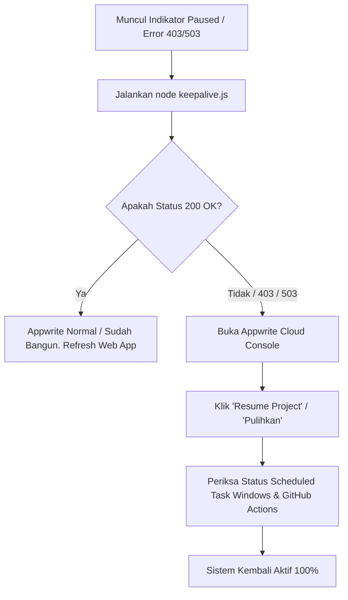
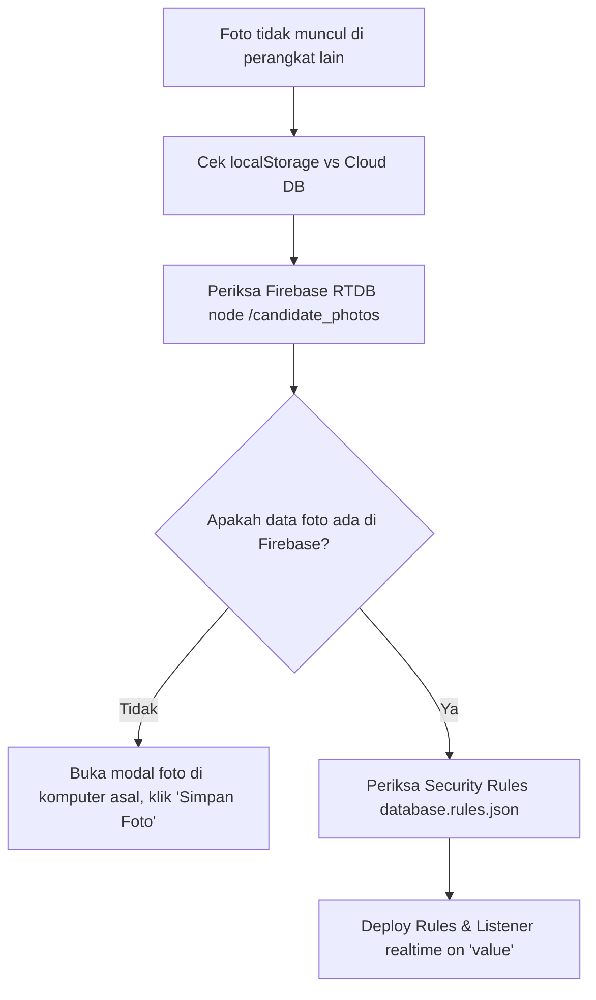

# 🛠️ PGE Talent Pool — Structured Debug & Incident Recovery SOP

Dokumen ini adalah panduan standar operasional (*Standard Operating Procedure*) untuk diagnosa, investigasi terstruktur (*root-cause debugging*), dan pemulihan cepat (*incident resolution*) saat terjadi kendala teknis pada sistem PGE Talent Pool.

---

## 📑 DAFTAR ISI KASUS & INVESTIGASI
1. [Kasus 1: Backend Appwrite Paused / Koneksi Database Terputus](#1-kasus-1-backend-appwrite-paused--koneksi-database-terputus)
2. [Kasus 2: Foto Kandidat Tidak Muncul di Perangkat Lain](#2-kasus-2-foto-kandidat-tidak-muncul-di-perangkat-lain)
3. [Kasus 3: Report Card Terpotong Saat Dicetak ke PDF/Kertas](#3-kasus-3-report-card-terpotong-saat-dicetak-ke-pdfkertas)
4. [Kasus 4: Deployment & Validasi Sintaks Pra-Rilis](#4-kasus-4-deployment--validasi-sintaks-pra-rilis)
5. [Quick Diagnostic Command Cheat Sheet](#5-quick-diagnostic-command-cheat-sheet)

---

## 1. Kasus 1: Backend Appwrite Paused / Koneksi Database Terputus

### 🔍 Gejala (Symptoms)
- Muncul banner peringatan kuning di atas layar: *"Appwrite Cloud Project Dijeda (Paused Due to Inactivity)"*.
- Indikator status di pojok kanan berputar terus (*Menghubungkan ke Appwrite Cloud... ⏳*) atau merah.
- Console browser memunculkan error `HTTP 403 Forbidden` atau `HTTP 503 Service Unavailable`.

### 🧠 Akar Masalah (Root Cause)
Appwrite Cloud (Starter Tier) secara otomatis menonaktifkan (*auto-pause*) project jika tidak ada aktivitas API atau login konsol selama 7–14 hari berturut-turut.

### 📋 Langkah Diagnosa Terstruktur (Step-by-Step Debugging)



1. **Jalankan Uji Ping Manual**:
   Buka terminal di root project dan jalankan:
   ```powershell
   node keepalive.js
   ```
   - **Jika Output `✅ SUCCESS (HTTP 200)`**: Project sudah aktif. Refresh halaman aplikasi.
   - **Jika Output `⚠️ HTTP 403 / 503`**: Lanjut ke Langkah 2.

2. **Pulihkan dari Console Appwrite**:
   - Buka konsol Appwrite: [https://cloud.appwrite.io/console/project-6a9131260006737c5919](https://cloud.appwrite.io/console/project-6a9131260006737c5919)
   - Klik tombol **"Resume Project"** / **"Restore"**. Project akan aktif kembali dalam ~30 detik.

3. **Periksa Otomasi Penjaga (Prevention Health Check)**:
   - **Cek Scheduled Task Windows (Lokal)**:
     ```powershell
     Get-ScheduledTask -TaskName "AppwriteKeepAlive"
     ```
     *Pastikan `State` bernilai `Ready`. Jika terhenti, jalankan: `Start-ScheduledTask -TaskName "AppwriteKeepAlive"`.*
   - **Cek GitHub Actions Workflow (Cloud 24/7)**:
     File workflow: `.github/workflows/appwrite-keepalive.yml`
     *Catatan: GitHub mematikan cron otomatis jika repo tidak ada commit selama >60 hari. Cukup trigger manual 'Run workflow' di tab Actions jika nonaktif.*

4. **Verifikasi Fallback Architecture**:
   Sistem PGE Talent Pool dilengkapi **Dual-Layer Database Sync**:
   - Jika Appwrite down/paused, sistem otomatis membaca data dari **Firebase Realtime Database** (`loadFirebaseTalentsFallback()`), sehingga operasional HR tetap berjalan tanpa data hilang.

---

## 2. Kasus 2: Foto Kandidat Tidak Muncul di Perangkat Lain

### 🔍 Gejala (Symptoms)
- Foto profil kandidat muncul di komputer A, namun saat dibuka di komputer B atau incognito, foto kembali menjadi inisial (lingkaran abu-abu).

### 🧠 Akar Masalah (Root Cause)
Foto kandidat sebelumnya hanya tersimpan di `localStorage` peramban lokal komputer A, dan belum tersinkronisasi ke database cloud pusat.

### 📋 Langkah Diagnosa Terstruktur



1. **Periksa Node Foto Cloud di Firebase Realtime Database**:
   - Pastikan path `/candidate_photos/<TALENT_ID>` memiliki data Base64 / URL gambar.
   - Fungsi `saveActiveCandidatePhoto()` di `public/index.html` menyimpan secara paralel ke:
     - `localStorage.setItem('pge_candidate_photo_' + id, data)` (Cache instan)
     - `firebase.database().ref('/candidate_photos/' + id).set({ photoUrl: ... })` (Cloud sync)
     - `firebase.database().ref('/talents/' + id + '/photoUrl').set(...)` (Sync talent)

2. **Periksa Rule Izin Akses Firebase (`database.rules.json`)**:
   Pastikan node `candidate_photos` mengizinkan baca & tulis untuk user terautentikasi:
   ```json
   "candidate_photos": {
     ".read": "auth != null",
     ".write": "auth != null"
   }
   ```

3. **Verifikasi Listener Realtime**:
   Pastikan di `bootApp()` fungsi listener Firebase aktif:
   ```javascript
   rtdb.ref('/candidate_photos').on('value', snapshot => {
     const photos = snapshot.val() || {};
     // Otomatis memperbarui avatar seluruh kandidat yang sedang tampil
   });
   ```

---

## 3. Kasus 3: Report Card Terpotong Saat Dicetak ke PDF/Kertas

### 🔍 Gejala (Symptoms)
- Saat klik **"Cetak / Download PDF Report Card"**, halaman ke-2 terpotong atau grafik kognitif/pentagon tumpang tindih.

### 🧠 Akar Masalah (Root Cause)
Grafik SVG interactive mode menggunakan dimensi visual yang dirancang untuk layar lebar (`viewBox 580px`, gauge radius `46px`), bukan spesifikasi A4 print container.

### 📋 Solusi & Standar Layout Print

1. **Gunakan Parameter `isPrint=true`**:
   Fungsi visualisasi wajib mendukung dual mode:
   ```javascript
   // Di dalam printCandidateReportCard():
   const cognitiveMarkup = renderCognitiveAspectsBarsHtml(assessment.cognitive, talent.id, true);
   ```
2. **Ukuran Baku Mode Print**:
   - Gauge Radius: `r = 32px` (diameter ring 72px).
   - SVG Box: `viewBox="0 0 530 120"`.
   - Bar Height: `rowH = 20px` (maksimal 5 bar aspek = 100px total).
   - Card padding: `7px 9px` dengan `margin-bottom: 0`.

---

## 4. Kasus 4: Deployment & Validasi Sintaks Pra-Rilis

### 🔍 Langkah Validasi Sebelum Deploy (Pre-flight Checklist)

1. **Uji Validasi Sintaks JavaScript & HTML**:
   Gunakan Node.js inline runner untuk memverifikasi seluruh blok script di `public/index.html` dan `public/assessment-portal.html`:
   ```powershell
   node scratch/validate_syntax.js
   ```
   *Output wajib: `=== ALL SCRIPTS ARE 100% SYNTAX CLEAN ===`.*

2. **Deploy ke Firebase Hosting**:
   ```powershell
   npx firebase-tools deploy --only hosting --project talentpool-34137
   ```

3. **Verifikasi URL Produksi**:
   - Production Portal: [https://pge-talentpool.web.app](https://pge-talentpool.web.app)
   - Secondary Alias: [https://talentpool-34137.web.app](https://talentpool-34137.web.app)

---

## 5. Quick Diagnostic Command Cheat Sheet

| Kebutuhan Diagnosa | Perintah Terminal (PowerShell) |
| :--- | :--- |
| **Tes Ping Appwrite Langsung** | `node keepalive.js` |
| **Cek Task Background Windows** | `Get-ScheduledTask -TaskName "AppwriteKeepAlive"` |
| **Jalankan Ulang Task Windows** | `Start-ScheduledTask -TaskName "AppwriteKeepAlive"` |
| **Deploy Hosting Cepat** | `npx firebase-tools deploy --only hosting --project talentpool-34137` |
| **Deploy Security Rules** | `npx firebase-tools deploy --only database --project talentpool-34137` |
| **Cek Git Status** | `git status` |
